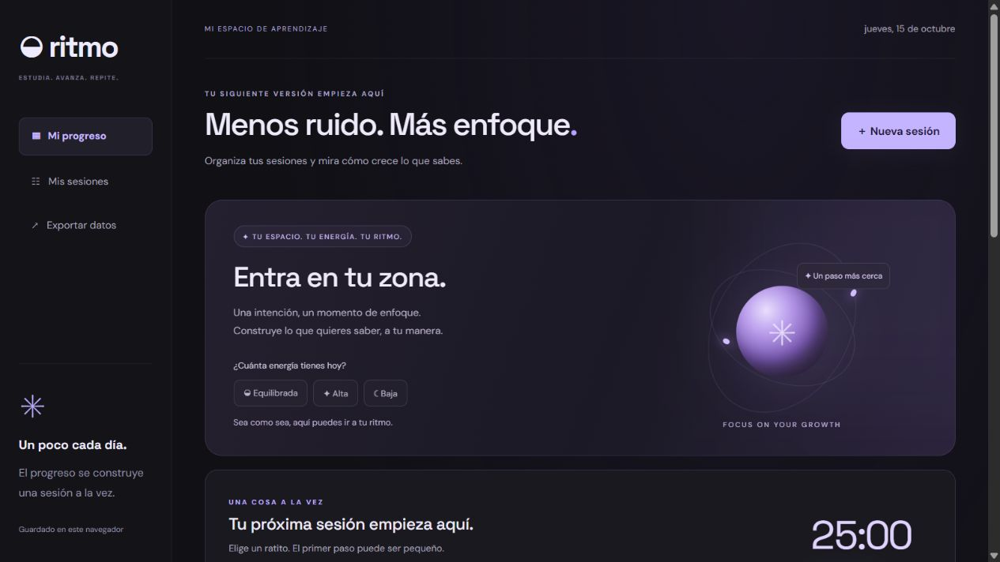
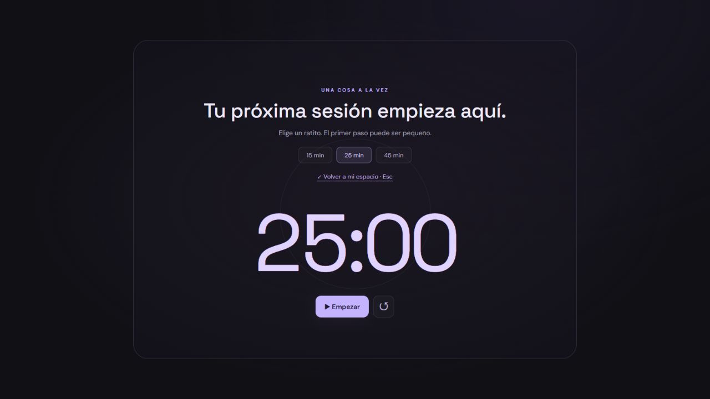

# Ritmo · Tu espacio de estudio

Una app web para registrar lo que aprendes, concentrarte y visualizar tu progreso. Desarrollada con HTML, CSS y JavaScript.

[Probar la app](https://nayelisantos19.github.io/ritmo-study-app/) · [Mi portafolio](https://nayelisantos19.github.io/)

## Funciones

- Registro de sesiones con tema, materia, fecha, minutos y notas.
- Resumen de tiempo estudiado, sesiones y días activos.
- Gráfico semanal y meta de estudio editable.
- Temporizador de 15, 25 o 45 minutos con pausa y continuación.
- Modo inmersivo para reducir distracciones.
- Sugerencias de duración según tu energía, mediante reglas locales.
- Búsqueda de sesiones, eliminación con confirmación y exportación JSON.
- Diseño adaptable a móviles y animaciones que respetan movimiento reducido.

## Cómo usarla

Descarga el repositorio y abre `index.html` en un navegador moderno. También puedes abrir la carpeta en Visual Studio Code y usar Live Server.

1. Selecciona tu nivel de energía o una duración de enfoque.
2. Inicia el temporizador. Puedes pausarlo o entrar en modo inmersivo.
3. Al terminar, registra tu sesión; también puedes añadir sesiones manualmente.
4. Consulta tu progreso y ajusta tu meta semanal.

## Estructura

- `index.html`: estructura y formularios.
- `styles.css`: estilos base y diseño adaptable.
- `modern.css`: apariencia moderna, orbe animado y modo inmersivo.
- `app.js`: sesiones, almacenamiento y cálculos.
- `focus.js`: temporizador y celebraciones.
- `experience.js`: modo inmersivo y sugerencias según la energía.

## Datos y límites

Los datos se guardan con localStorage en el navegador donde uses la app. No hay cuentas ni sincronización entre dispositivos. La exportación descarga una copia JSON; aún no hay importación. El temporizador requiere que la página siga abierta y se reinicia al recargarla. Las fuentes de Google son opcionales: si no están disponibles, se usan fuentes del sistema. Las sugerencias de duración no usan IA.

## Aprendizaje y próximos pasos

Proyecto de portafolio desarrollado con asistencia de Codex, enfocado en practicar estructura semántica, CSS adaptable, eventos de JavaScript, gestión de estado y persistencia local.

Próximas mejoras: editar sesiones, importar copias de seguridad y sincronizar entre dispositivos.

## Modo de enfoque

