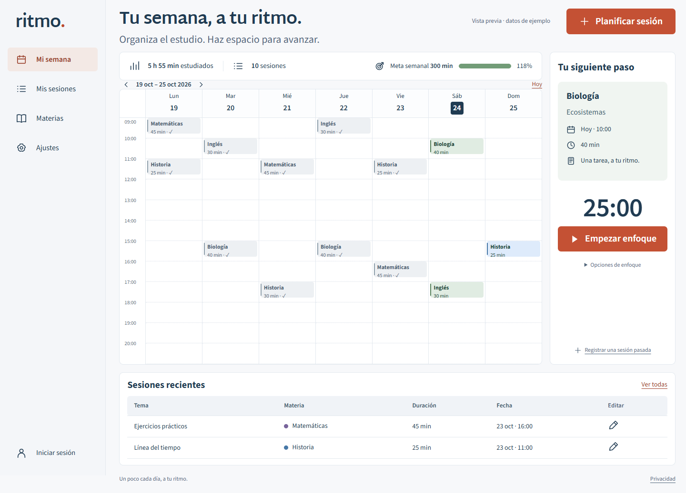

# Ritmo · Tu semana, a tu ritmo.

Planifica el estudio por horas y sigue tu progreso por materia. Aplicación en español con HTML semántico, CSS y JavaScript sin React ni Vite; servidor Node.js 24 y base de datos SQLite real.

> Esta versión requiere un servidor. GitHub Pages no puede alojar la autenticación ni la base de datos. La configuración de despliegue está preparada, pero todavía no hay una nueva instalación pública.



## Ejecutar localmente

Necesitas Node.js 24.13 o posterior de la rama 24. No hay dependencias de producción ni compilación del frontend.

```sh
git clone https://github.com/NayeliSantos19/ritmo-study-app.git
cd ritmo-study-app
git switch feat/ritmo-professional-redesign
npm start
```

Abre **http://localhost:3000**. El servidor crea `data/ritmo.sqlite` y aplica las migraciones. Usa `localhost` para que el origen coincida con la protección de solicitudes.

Para personalizar la configuración, copia `.env.example` a `.env` y ejecuta:

```sh
node --env-file=.env server/index.js
```

`SITE_URL` debe coincidir con la URL que abres. No introduzcas contraseñas ni datos personales en el repositorio.

## Funciones

- Planificar, editar y eliminar sesiones; los solapamientos se muestran en carriles.
- Navegar entre semanas; las sesiones fuera del horario habitual amplían el calendario.
- Registrar sesiones completadas y consultar tiempo, meta semanal y materias.
- Buscar, exportar JSON e importar copias de esta versión o de la anterior.
- Temporizador con pausa, restauración al recargar y modo de enfoque.
- Cuentas para consultar el estudio guardado en el mismo servidor desde otros dispositivos.

## Tres formas de entrar

**Vista previa:** datos ilustrativos etiquetados. No se copian automáticamente a una cuenta.

**Modo local:** sesiones en este navegador. Si editas una sesión de ejemplo, solo esa sesión editada pasa a tu espacio local. Exporta una copia antes de borrar los datos del navegador.

**Cuenta:** correo, contraseña protegida, sesiones y meta en SQLite. Cada cuenta nueva empieza vacía. En Ajustes puedes importar explícitamente tus sesiones locales a tu cuenta.

La sincronización consulta el servidor al abrir la aplicación y volver a una pestaña; no utiliza WebSockets ni combina ediciones simultáneas. Si dos dispositivos editan la misma sesión, se conserva la última escritura.

## Arquitectura

```text
public/                 HTML inicial, estilos, módulos y fuentes locales
  app.js                Interacciones y coordinación de la interfaz
  domain.js             Fechas, validación, importación y cálculos compartidos
  icons.js              Iconos SVG
server/
  index.js              HTTP, API, accesos y páginas públicas
  auth.js               Contraseñas y tokens
  database.js           Conexión y migraciones transaccionales
  migrations/           Esquema SQL versionado
scripts/                Copias y mantenimiento de cuentas
tests/                  Dominio, API y recorrido en navegador
docs/DEPLOY.md          Despliegue fuera de Vercel
DESIGN.md               Sistema visual con Impeccable
```

SQLite es una base de datos real: esta instalación usa una instancia con disco persistente. No coloques el archivo en disco efímero ni lo compartas entre réplicas. Para varias instancias habría que migrar a una base de datos de servidor.

## Seguridad y privacidad

- Contraseñas con `scrypt`, sal aleatoria y comparación de tiempo constante.
- Tokens aleatorios; solo sus resúmenes criptográficos se guardan en la base.
- Cookie `HttpOnly`, `SameSite=Lax`, siete días; `Secure` y `__Host-` en producción.
- Protección por origen y cabecera propia, validación, consultas parametrizadas y propiedad por usuario.
- Límites persistentes de acceso y escrituras; contadores con resúmenes de IP/correo.
- Cabeceras de seguridad, CSP, fuentes locales y ausencia de analítica o publicidad.

No hay verificación de correo ni recuperación automática de contraseña. El correo es un identificador, no una titularidad verificada. La administración dispone de scripts de mantenimiento. Antes de abrir una instalación pública, configura HTTPS, soporte, copias de seguridad y conservación.

## SEO y respuestas HTTP

El HTML inicial contiene navegación, encabezados, formularios y descripción. El calendario personalizado se carga con JavaScript. Las páginas públicas tienen metadatos propios, canonical y OG; la portada incluye `WebApplication`. Las sesiones privadas no se publican y las páginas autenticadas llevan `noindex`.

El servidor ofrece `/robots.txt`, `/sitemap.xml`, `/llms.txt`, `/privacidad`, OG de 1200 × 630 y una página 404 con estado **404**. `llms.txt` no garantiza visibilidad en asistentes. Define `SITE_URL` con el dominio definitivo.

## Verificar

```sh
npm ci
npm test
npm run format:check
npm run format
```

Se prueban validación, semanas, copias, autenticación, aislamiento, importación atómica/idempotente, persistencia tras reiniciar, cierre de sesión, límites, metadatos y HTTP 404. GitHub Actions ejecuta pruebas y formato.

Para el recorrido en navegador:

```sh
npx playwright install chromium
npm run test:browser
```

Con Edge instalado, puedes usar `BROWSER_CHANNEL=msedge` en el entorno. La prueba usa una base temporal y no toca la instalación del puerto 3000.

El temporizador requiere la página abierta y no envía notificaciones. El calendario móvil tiene desplazamiento propio. Las importaciones admiten 2000 sesiones y 2 MB; se validan antes de escribir.

## Despliegue

Consulta [la guía de despliegue y mantenimiento](docs/DEPLOY.md): Docker Compose, HTTPS con Caddy y volumen persistente. No depende de Vercel ni de un proveedor concreto.

## Créditos

Proyecto de Nayeli Santos, desarrollado con asistencia de Codex. Rediseño con **Impeccable** y propuesta aprobada por la autora. Martel Sans y Source Sans 3 incluyen licencias OFL en `public/assets/`. Los datos de ejemplo son sintéticos. OG utiliza tipografía y geometría de calendario.
